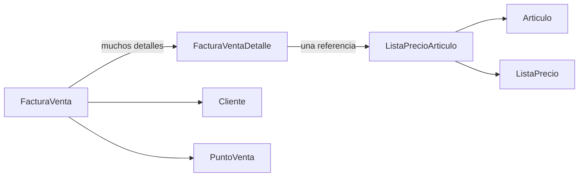

# Qué hacemos, por qué y para qué sirve

## 1. El problema que resuelve este trabajo

En Java trabajamos con objetos: una factura tiene un cliente y una lista de detalles. Una base relacional guarda filas, columnas y claves foráneas. El trabajo consiste en describir cómo convertir esa estructura de objetos en tablas y cómo recuperarla después.

**ORM** significa mapeo objeto-relacional. **JPA** define el contrato y las anotaciones para describir ese mapeo. **Hibernate** implementa JPA y genera el SQL. **PostgreSQL** guarda los datos. **JDBC** es el mecanismo de conexión entre Java y la base.

El recorrido es:

```text
Objetos Java -> EntityManager (JPA) -> Hibernate -> JDBC -> PostgreSQL
```

Esto sirve para conservar la información aunque el programa termine. Las anotaciones describen la correspondencia; los datos siguen estando en una base relacional y pueden consultarse con SQL.

## 2. Por qué es un proyecto de consola

La consigna se centra en entidades, configuración y una transacción desde `Main`. Una aplicación de consola permite observar ese recorrido directamente. Maven organiza el proyecto, descarga las bibliotecas y ejecuta las pruebas.

El proyecto tiene tres responsabilidades principales:

| Parte | Qué hace | Para qué sirve |
| --- | --- | --- |
| `modelo/` | Describe entidades, campos y relaciones | Le indica a Hibernate cómo guardar los objetos |
| `DatosEjemplo` | Construye una factura y sus referencias | Permite leer el ejemplo sin mezclarlo con la configuración |
| `Main` | Abre JPA, guarda y vuelve a consultar | Demuestra la persistencia y la cascada exigidas |

`ConfiguracionJpa` toma las credenciales de la terminal. `persistence.xml` contiene la unidad de persistencia.

## 3. Primero definimos identidad y auditoría

`EntityId` contiene un `Long id` con `@Id` y `@GeneratedValue(strategy = IDENTITY)`. La base asigna el identificador al insertar una fila. Ese ID permite distinguir dos objetos aunque tengan descripciones iguales.

`AuditoriaApp` agrega cuándo se creó, modificó o dio de baja un registro y qué usuario hizo cada operación. Las fechas de alta y modificación y sus usuarios son obligatorios. Los datos de baja son opcionales porque un registro nuevo todavía no fue dado de baja.

Ambas usan `@MappedSuperclass`: sus campos se heredan como columnas de las entidades hijas. **No generan tablas propias.** Por ejemplo, `facturas_venta` tiene tanto `id` como `fecha_alta` y `usuario_carga_id`.

`registrarAlta(usuario)` inicializa fechas y usuarios. `registrarModificacion(usuario)` registra quién modificó. `registrarBaja(usuario)` registra una baja lógica: completa campos, pero no borra la fila. Los callbacks `@PrePersist` y `@PreUpdate` completan o actualizan las fechas; el programa debe indicar el usuario responsable.

Esos datos sirven para rastrear cambios. Este ejercicio no implementa un historial de todas las versiones: conserva los campos de auditoría del modelo provisto.

## 4. Convertimos cada clase concreta en una tabla

Cada clase concreta tiene `@Entity` y `@Table(name = "...")`. `@Entity` la incorpora al modelo de JPA; `@Table` define el nombre SQL.

Ejemplo conceptual:

```java
@Entity
@Table(name = "articulos")
public class Articulo extends AuditoriaApp {
    @Column(name = "codigo", nullable = false)
    private String codigo;
}
```

Una instancia de `Articulo` corresponde a una fila de `articulos`. El atributo `codigo` corresponde a una columna. `nullable = false` indica que ese dato debe existir, tanto para el mapeo como para la restricción `NOT NULL` que Hibernate genera en el esquema.

Esto no valida por sí mismo que un texto tenga contenido: `""` es distinto de `null`. La consigna pide obligatoriedad mediante `NOT NULL`, sin añadir reglas de negocio no definidas.

Los constructores públicos sin argumentos permiten que JPA reconstruya los objetos al leer la base. Los getters y setters permiten cargar y consultar sus datos sin usar Lombok ni generar código durante la compilación.

## 5. Relacionamos los objetos

### Muchos a uno: `@ManyToOne`

Muchas facturas pueden apuntar al mismo punto de venta. Muchos artículos pueden compartir una marca. Muchos registros de auditoría pueden apuntar al mismo usuario.

En SQL, el lado que guarda la referencia tiene una clave foránea. Por ejemplo, `facturas_venta.punto_venta_id` apunta a `puntos_venta.id`.

```java
@ManyToOne(fetch = FetchType.LAZY, optional = false, cascade = CascadeType.PERSIST)
@JoinColumn(name = "punto_venta_id", nullable = false)
private PuntoVenta puntoVenta;
```

`optional = false` declara que la referencia es obligatoria en el modelo. `nullable = false` la hace obligatoria en la columna. `LAZY` solicita cargar la referencia cuando se utiliza, dentro de un contexto de persistencia abierto; algunos tipos de asociación pueden requerir una carga anticipada según el proveedor.

### Uno a muchos: factura y detalles

Una factura contiene varios renglones. Cada renglón corresponde a una factura.



La relación se describe en ambos lados:

```java
// En FacturaVenta
@OneToMany(mappedBy = "factura", cascade = CascadeType.ALL, orphanRemoval = true)
private List<FacturaVentaDetalle> detalles = new ArrayList<>();

// En FacturaVentaDetalle
@ManyToOne(fetch = FetchType.LAZY, optional = false)
@JoinColumn(name = "factura_id", nullable = false)
private FacturaVenta factura;
```

**El dueño de la relación es el detalle**, porque su tabla contiene `factura_id`. `mappedBy = "factura"` nombra exactamente el atributo Java de ese lado; no es el nombre de la tabla ni el de la columna.

`agregarDetalle(detalle)` hace dos cosas juntas:

```java
detalles.add(detalle);
detalle.setFactura(this);
```

Así se mantienen sincronizados los dos extremos. Agregar un objeto solamente a una lista no alcanza para establecer la clave foránea si el lado dueño sigue apuntando a `null`.

`quitarDetalle` rompe ambos vínculos. Como se añadió `orphanRemoval = true`, Hibernate elimina de la base un detalle que deja de pertenecer a su factura. Es una decisión del ejemplo para reflejar que el renglón depende de su cabecera. Después de cambiar detalles hay que llamar a `recalcularTotal()`.

### Uno a uno: cliente, contacto y domicilio

La consigna pide un contacto y un domicilio obligatorios por cliente. Se usa `@OneToOne` y claves foráneas con `nullable = false, unique = true`. `UNIQUE` impide que dos clientes compartan la misma fila de contacto o de domicilio.

La factura, en cambio, puede tener `cliente = null`, porque así está indicado en el modelo docente.

## 6. Por qué la cascada permite un solo `persist`

La línea central del trabajo es:

```java
em.persist(facturaVenta);
```

`persist` hace que un objeto nuevo quede administrado por JPA para insertarse en la base. Hibernate recorre las relaciones que tienen cascada de persistencia.

| Relación | Cascada elegida | Motivo |
| --- | --- | --- |
| Factura -> detalles | `ALL` | Es lo exigido; los detalles dependen de la factura |
| Factura -> cliente, moneda, condición IVA, punto de venta | `PERSIST` | Permite crear las referencias nuevas del ejemplo |
| Detalle -> precio, precio -> artículo/lista, artículo -> marca/rubro | `PERSIST` | Permite guardar el grafo nuevo desde la cabecera |
| Entidad auditada -> usuario | `PERSIST` | El usuario nuevo del ejemplo también debe guardarse |
| Cliente -> contacto y domicilio | `PERSIST` | Guarda las referencias obligatorias nuevas |
| Detalle -> factura | Sin cascada | Es el vínculo de retorno; la operación empieza en la cabecera |

`ALL` incluye persistir, fusionar, eliminar, refrescar y desvincular. Se usa solo para los detalles. `PERSIST` no propaga el borrado. Por eso eliminar una factura puede eliminar sus renglones sin borrar los artículos, el cliente o el usuario.

**Una llamada Java no equivale a una sola sentencia SQL.** Hibernate genera varios `INSERT`, uno por fila, y los coordina con las claves foráneas. En el ejemplo hay 17 filas repartidas en 14 tablas: dos detalles, dos artículos y dos precios, más una fila por cada entidad restante. Todas las referencias de auditoría usan el mismo objeto `Usuario`, que se inserta una sola vez.

Si las referencias ya existen, se recuperan con `find`, una consulta o `getReference` en el contexto actual. No se construyen objetos nuevos con datos parecidos ni se asignan IDs manualmente. Una prueba muestra dos facturas que comparten esas referencias sin duplicarlas. Una referencia separada de un contexto anterior no debe pasarse sin más a una cascada `PERSIST`.

## 7. Configuramos cómo conectarnos

`src/main/resources/META-INF/persistence.xml` define `FacturacionPU`. Ese nombre debe coincidir con el que utiliza `Persistence.createEntityManagerFactory(...)`.

El archivo establece el proveedor Hibernate, las entidades, el driver PostgreSQL, la URL JDBC, el usuario y las propiedades exigidas:

- `hibernate.show_sql = true`: muestra las sentencias ejecutadas.
- `hibernate.format_sql = true`: presenta el SQL con formato legible.
- `hibernate.hbm2ddl.auto = update`: crea o actualiza el esquema al iniciar, conservando los registros.

La base y el usuario deben existir previamente: `update` crea tablas, pero no crea el servidor ni la base PostgreSQL. Las variables `DB_URL`, `DB_USER` y `DB_PASSWORD` pueden sobreescribir la conexión del XML desde la terminal.

Esto permite cambiar la conexión sin editar las entidades. El driver JDBC y el dialecto siguen siendo los de PostgreSQL; cambiar únicamente la URL por una de MySQL no migra esta configuración.

## 8. Guardamos todo dentro de una transacción

Una transacción agrupa operaciones que deben tener éxito juntas. Si se guarda una factura pero fallan sus detalles, el resultado queda incompleto. `rollback` revierte las inserciones de esa transacción.

El recorrido de `Main` es:

1. Crear el `EntityManagerFactory`, que conoce la configuración y el mapeo.
2. Obtener un `EntityManager`, que administra los objetos de esta operación.
3. Ejecutar `begin()` para iniciar la transacción.
4. Construir todos los objetos nuevos con `DatosEjemplo.crearFactura()`.
5. Llamar una única vez a `em.persist(facturaVenta)`.
6. Ejecutar `commit()` para confirmar.
7. Ante un error, ejecutar `rollback()` si la transacción sigue activa y propagar el error.
8. Cerrar `EntityManager` y `EntityManagerFactory` mediante bloques `finally`.

Con `IDENTITY`, algunos `INSERT` pueden ejecutarse durante `persist` para obtener IDs. Eso no reemplaza `commit`: la transacción todavía puede revertirse.

El cierre de recursos libera conexiones. En una aplicación mayor suele existir una fábrica compartida durante la vida de la aplicación y un administrador por unidad de trabajo; este programa abre y cierra ambos en su única ejecución.

## 9. Comprobamos que los datos están en la base

Después de guardar, `Main` llama a `em.clear()`. Esto desvincula los objetos del contexto: evita confundir los objetos que teníamos en memoria con una lectura nueva.

Luego abre una transacción de lectura y consulta la factura mediante JPQL, trayendo también sus detalles con `join fetch`. JPQL utiliza nombres de entidades y atributos Java; Hibernate lo traduce al SQL correspondiente.

Se comprueban dos detalles y se imprime:

```text
2 cuadernos x 1250,50 = 2501,00
3 lapiceras x 350,00 = 1050,00
Total = 3551,00
```

`recalcularTotal()` suma los subtotales definidos y calcula el saldo restando lo cobrado. El ejemplo no define reglas de alícuotas ni de autorización fiscal. Los precios del renglón quedan guardados en el detalle, lo que permite conservar el importe de esa operación aunque después cambie una lista de precios.

## 10. Qué verifican las pruebas

Las pruebas ejecutan Hibernate y una base relacional real, no objetos simulados. Por defecto usan H2 en memoria; también pueden ejecutarse contra una base PostgreSQL descartable.

1. Una única persistencia guarda las 14 clases de entidad y recupera todos los vínculos.
2. Un dato obligatorio faltante provoca error y revierte el grafo insertado.
3. La base rechaza `NULL` en una columna obligatoria incluso con SQL directo.
4. Cliente de factura, marca y rubro admiten `null` donde lo permite la consigna.
5. La restricción uno a uno impide compartir contacto o domicilio entre clientes.
6. Borrar una factura borra sus detalles y conserva las referencias compartidas.
7. Quitar un detalle elimina el huérfano y conserva el resto.
8. Un `rollback` explícito deshace las inserciones del ejemplo completo.
9. Una segunda factura puede reutilizar cliente, artículos y usuario sin duplicarlos.

`create-drop` pertenece solo a las pruebas, que necesitan un esquema descartable. El programa principal usa `update`.

## 11. Cómo explicarlo en una exposición

Podés seguir este orden mientras mostrás el código:

1. Abrir `EntityId` y `AuditoriaApp`: explicar herencia de columnas, ID y auditoría.
2. Abrir `FacturaVentaDetalle`: mostrar que `factura_id` está en el lado dueño.
3. Abrir `FacturaVenta`: explicar `mappedBy`, `ALL` y `agregarDetalle`.
4. Mostrar una referencia `ManyToOne` y el `OneToOne` de `Cliente`.
5. Abrir `persistence.xml`: señalar el nombre de la unidad y PostgreSQL.
6. Abrir `Main`: mostrar transacción, único `persist`, `commit` y lectura posterior.
7. Ejecutar la demo y comprobar las filas con SQL o las pruebas.

La idea a transmitir es: **describimos el mapeo para que Hibernate traduzca un grafo de objetos en filas relacionadas; usamos cascada para propagar la persistencia y una transacción para conservar la integridad de la operación.**

Referencia técnica utilizada: [guía oficial de Hibernate ORM 5.6](https://docs.hibernate.org/orm/5.6/userguide/html_single/), apartados de herencia, asociaciones y contexto de persistencia.
